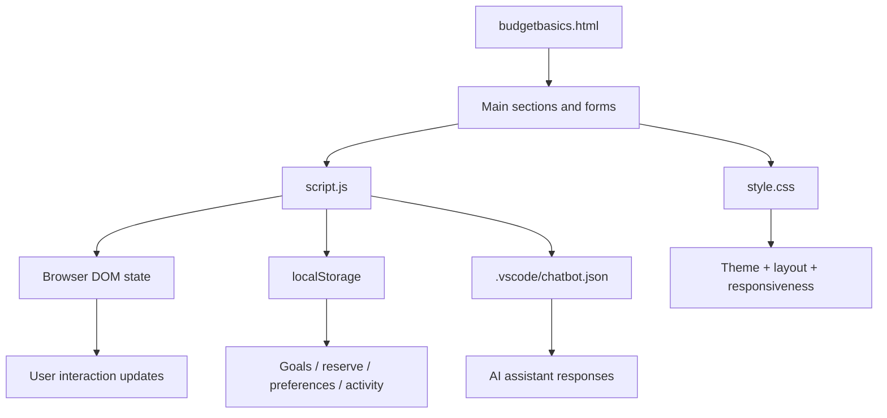
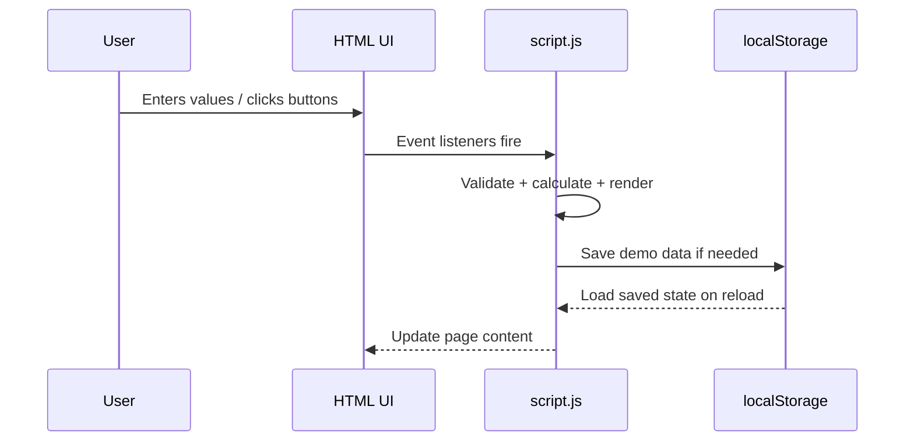

# Architecture

## Overview

BudgetBasics is a single-page static web application. The project follows a simple browser-only architecture:

- `budgetbasics.html` defines the structure of the interface
- `style.css` controls layout, colors, responsiveness, and theme styling
- `script.js` implements the logic for calculations, rendering, local state, persistence, and UI interactions
- `.vscode/chatbot.json` provides the local knowledge base used by the assistant

There is no backend API, database, framework, server, or deployment build pipeline. Everything runs in the browser, and the application stores state locally with `localStorage`.

## High-level component layout

## Major folders and responsibilities

### Root project folder

- `budgetbasics.html` — page structure, semantic sections, forms, dialogs, and app shell
- `script.js` — all client-side logic and rendering updates
- `style.css` — design system, layout, theme, hover/focus states, and responsiveness

### `.vscode/`

- `chatbot.json` — static answer bank and quick prompts used by the floating assistant

## Component relationships

The main functionality is organized into a few conceptual groups:

### 1. Educational content layer

Provides the static learning material:

- hero section
- basics cards
- needs vs wants section
- 50-30-20 rule section
- mistakes gallery
- about section

These sections are primarily informational and rendered from structured arrays or static markup inside the HTML.

### 2. Calculation and planner layer

This includes the interactive numerical tools:

- regular vs irregular income calculator
- monthly budget split output
- pending item tracker
- allowance vault release calculations

This behavior is implemented almost entirely in `script.js` and updates the DOM based on user input.

### 3. Goal simulation layer

The goal system creates goal records, controls progress, uses goal mode logic, calculates remaining balance, and tracks activity. It is one of the central features of the app.

Key responsibilities:

- storing goals in localStorage
- calculating progress percentages
- setting rigid vs flexible modes
- handling simulated early withdrawals
- rendering the activity timeline and savings insights
- showing a savings health indicator

### 4. Local persistence layer

The browser stores:

- theme selection
- user account demo data
- savings goals
- activity log
- reserve target/current values
- pending items
- allowance plan
- selected country/currency

The persistence layer is implemented with `localStorage` and JSON round-trips.

### 5. Chatbot layer

The `BudgetBot` assistant does not call a real API. Instead, it:

1. loads the JSON structure from `.vscode/chatbot.json`
2. matches the user query against question arrays
3. returns the best local response
4. renders the result in the floating chat panel

## Data flow

## Application flow

### Initial page load

1. The browser loads `budgetbasics.html`.
2. The HTML loads `style.css` and `script.js`.
3. `script.js` reads localStorage for saved state such as theme, country, goals, and reserve values.
4. The app updates the DOM to show saved preferences and calculated summaries.

### Example: creating a savings goal

1. User fills out goal form fields.
2. Validation runs in `script.js`.
3. The goal object is added to the in-memory array.
4. The array is saved to `localStorage`.
5. `renderSavingsGoals()` updates the dashboard and saved-goal list.
6. Activity is logged and the health score refreshes.

### Example: using the regular budget calculator

1. User enters monthly income.
2. The script converts it to numbers and validates input.
3. It calculates 50/30/20 shares.
4. The result is rendered into the result card with progress bars and currency formatting.

## Authentication flow

This project does not have a true authentication backend.

The “sign in / create account” dialog is a local demo system:

- account data is stored in `localStorage`
- passwords are hashed with a deterministic browser-side hash helper
- the active user is stored under a `bb-me` key
- users are kept in `bb-users`
- the sign-in state is used only for interface personalization

Important limitation:

- this is demonstration-only local auth, not secure production authentication
- it should not be treated as actual user identity management

## API flow

There is no formal API in the project.

The chatbot uses a local JSON file instead of a backend service. The app does not fetch data from a remote API during normal use.

## Database flow

There is no persistent database engine or server-side storage layer.

Actual browser data stores include:

- `bb-t` — theme preference
- `bb-v` — visitor count
- `bb-goals` — goal list
- `bb-allowance` — allowance plan
- `bb-pending` — pending items
- `bb-users` — demo user accounts
- `bb-me` — active demo user
- `bb-cc` — selected country/currency
- `bb-activity-v1` — activity timeline
- `bb-reserve-v1` — reserve plan
- `bb-preferences-v1` — UI preferences

## Security and trust model

This app is intentionally client-side and educational.

- no real backend or secrets are used
- no API key handling is necessary
- localStorage persists data on-device only
- no real financial system integration is present

## Summary

BudgetBasics follows a lightweight static-app architecture. Its complexity lives in the browser DOM and JavaScript logic rather than in a server or framework. The design prioritizes easy learning, local persistence, and user-friendly budgeting simulations over production-scale security and backend infrastructure.
